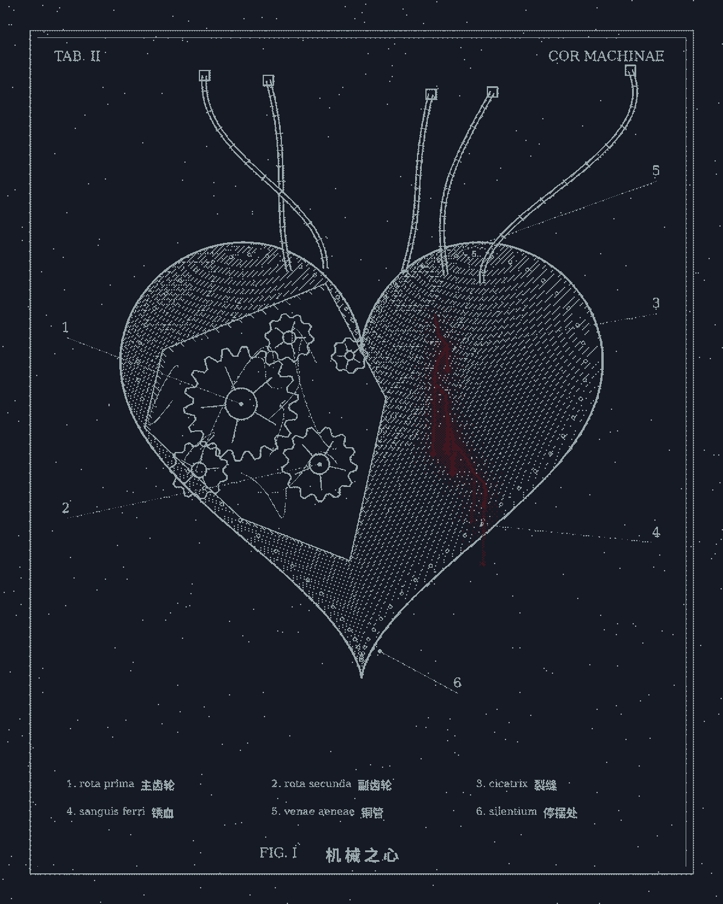
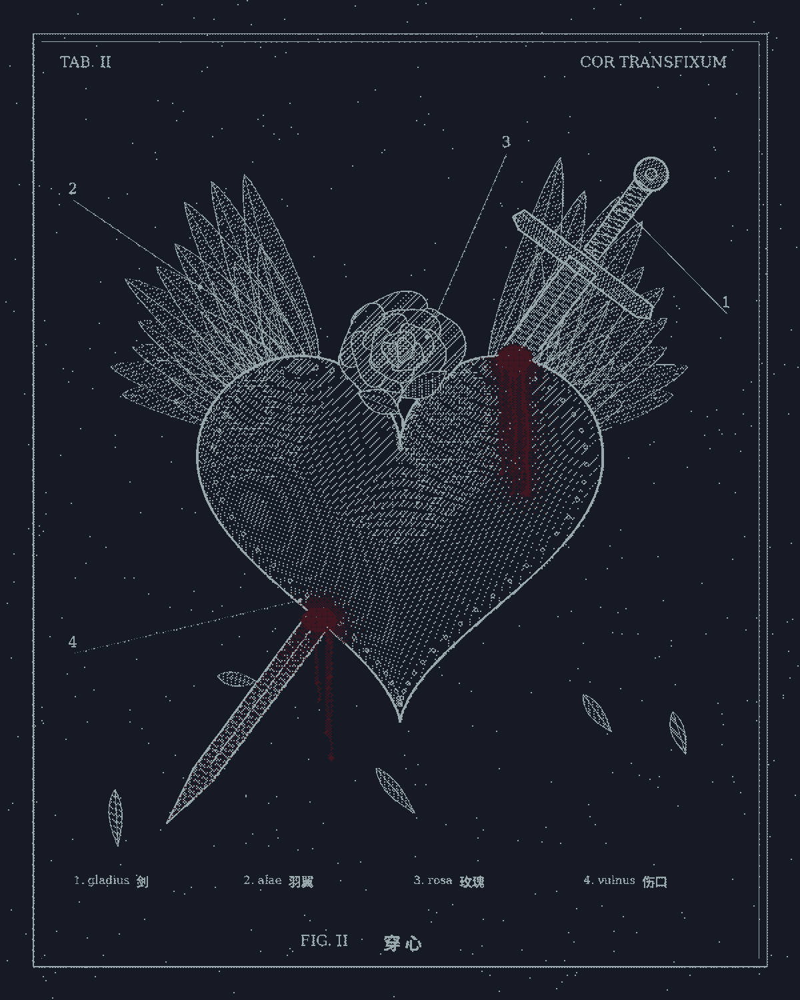
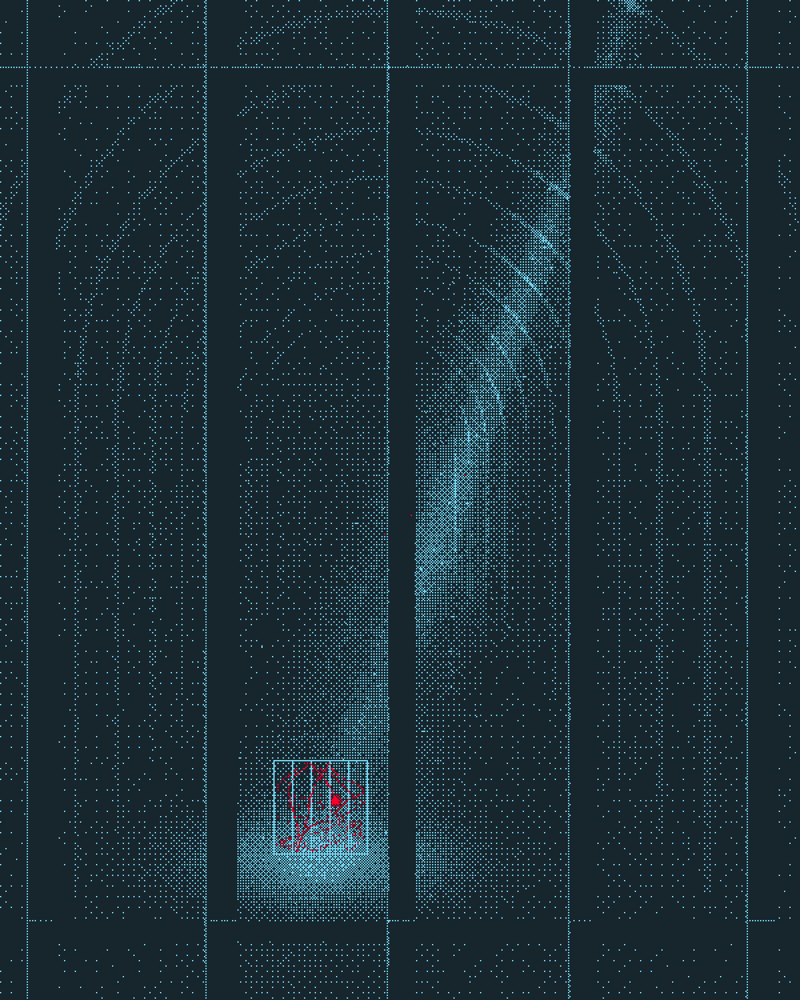
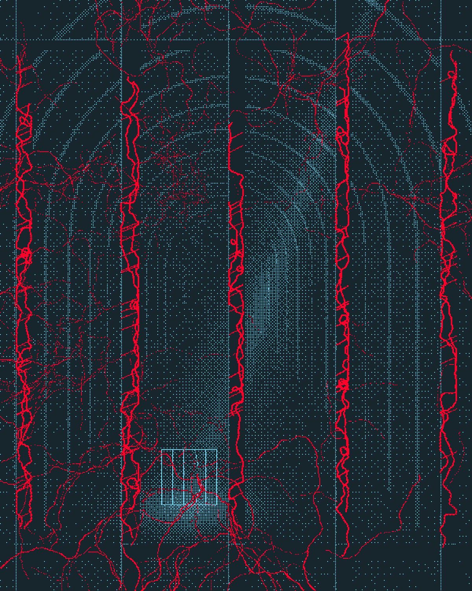
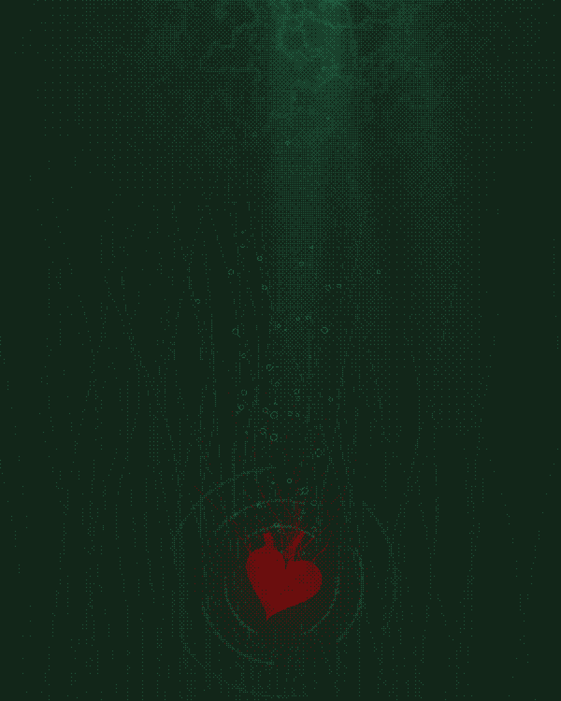
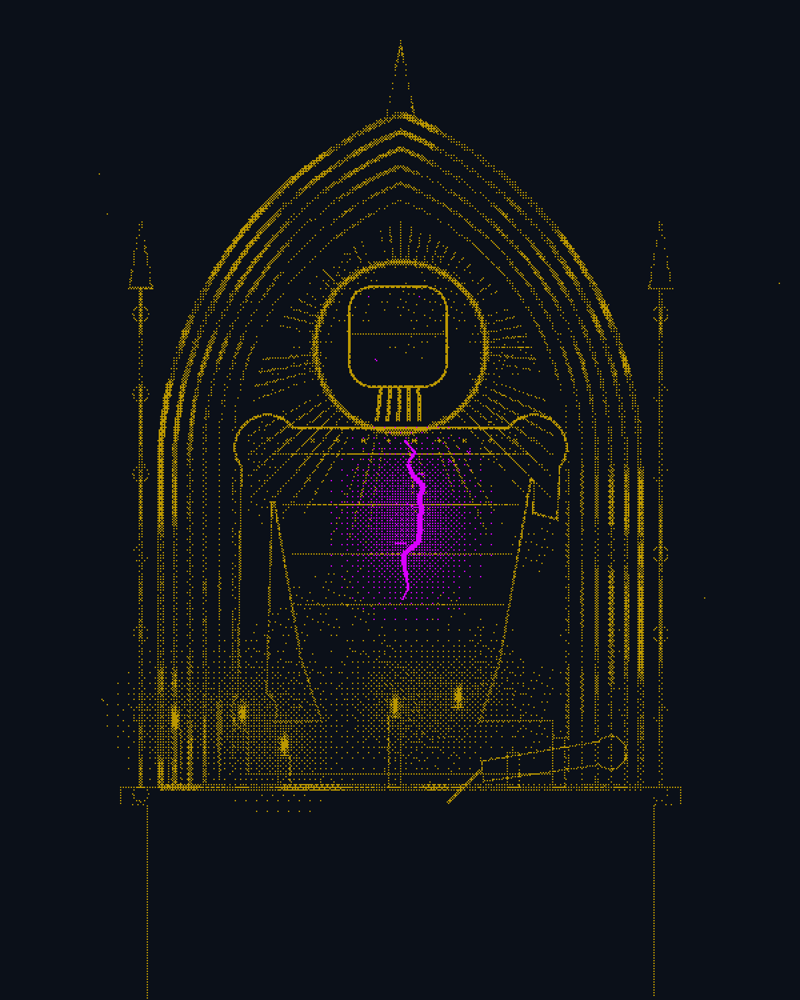

# 暗面三部曲 · Dark Trilogy

**三种颜色、一种情绪，一行行代码刻出来的暗黑版画。**

这是一个「代码画」Skill：不用任何 AI 生图模型，每一张都是 Python（numpy + Pillow）一个像素一个像素算出来的。整套作品走**版画语言**——每张只准用三种颜色，明暗全靠有序抖动的网点，像一本暗黑铜版画册。

同一个随机种子永远画出同一张图；换个种子，霉斑、火舌、红线都会长成另一种样子。


---

## 三幕

| 幕 | 情绪 | 三色（底 · 主色 · 点睛） | 参考 |
|---|---|---|---|
| 第一幕《糜烂》 | 黑暗、糜烂、丧 | `#000030` · `#610070` · `#18a69a` | 蚀刻版画 × 贝克辛斯基 |
| 第二幕《机械解剖》 | 爱、死亡、机器人 | `#161a24` · `#9aa9ad` · `#401720` | 文艺复兴解剖图版、达芬奇手稿 |
| 第三幕《无声》 | 禁锢、微弱的光、挣扎、无声 | `#17252d` · `#75d6f2` · `#ff002b` | 皮拉内西《想象的监狱》× 卡拉瓦乔 |

### 第一幕《糜烂》
一朵垂头的玫瑰，长满霉斑，花瓣一片片落下，青色的腐液往下淌。霉斑是 Gray-Scott 反应扩散"长"出来的，荧光青只出现在霉的边缘。


### 第二幕《机械解剖》
一本不存在的解剖图谱：被剖开的机械心脏。整颗心只有一道裂缝在渗锈血——那是全图唯一的「爱」。

| FIG. I《机械之心》 | FIG. II《穿心》 |
|---|---|
|  |  |

### 第三幕《无声》
无尽的拱廊、高窗漏下的一束光、光里一只小笼子，笼中的红点不停撞墙。第二张，光更弱了，笼子空了，红线爬满了墙。

| FIG. I《无声》 | FIG. II《蔓延》 |
|---|---|
|  |  |

---

## 扩展配色

三幕之外的两组三色，规则完全一样。

| 配色 | 三色（底 · 主色 · 点睛） | 作品 |
|---|---|---|
| 配色 4 | `#122619` · `#215d40` · `#6b0e0e` | 《沉没》 |
| 配色 5 | `#0b1019` · `#bc9800` · `#d900ff` | 《咒火》《神龛》 |

| 配色 4《沉没》 | 配色 5《咒火》 | 配色 5《神龛》 |
|---|---|---|
|  |  |  |

- **《沉没》**：深水底的森林，一颗还在跳的心沉在最底下，红色一丝丝渗进绿里。米莱斯《奥菲莉亚》，换成从水底往上看。
- **《咒火》**：火刑柱上仰头尖叫的女人。她是不是女巫没人知道，但紫色的诅咒从她嘴里升起，又像灰一样落回围观者头上。猎巫木刻传单 × 戈雅。
- **《神龛》**：金箔剥落的尖拱神龛里，供着的不是神，是一台坏掉的机器，紫光只从它胸口的裂缝漏出来。

---

## 自己跑一张

需要 Python 3.9+：

```bash
git clone https://github.com/Qisi3344/dark-trilogy-Skill.git
cd dark-trilogy-Skill
pip install numpy pillow scipy

python styles/act1-decay/act1_rose.py 5        # 第一个参数是随机种子
python styles/act2-anatomy/act2_anatomy.py 3
python styles/act2-anatomy/act2_pierced.py 11
python styles/act3-silence/act3_silence.py 7
python styles/act3-silence/act3_veins.py 7
python styles/palette4/sunken.py 4
python styles/palette5/witch.py 13
python styles/palette5/shrine.py 5
```

图片会存在当前目录，文件名带种子号（例如 `act1_rose_s5.png`），尺寸 1200×1500。上面这些种子就是示例图用的种子；换别的数字可以得到同一主题的另一张。每张大约几秒到一分钟。

第二幕默认是无字版。想要带拉丁文/中文图注、编号引线的「图谱版」：

```bash
TEXT=1 python styles/act2-anatomy/act2_anatomy.py 3
```

## 当作 AI Skill 用

`SKILL.md` 是给 AI 读的说明书（Claude Skills 格式），写了共用规则、每一幕的颜色和画法、怎么挑幕、出图后怎么自查。把整个文件夹放进支持 Skill 的 AI 工具（比如 Claude Code 的 `~/.claude/skills/dark-trilogy/`），然后说：

> 用暗面三部曲第三幕画一座灯塔

它就会照着三色、抖动、留黑的规矩，用代码画一张新的。

## 共用规则

每一张都遵守这几条，这也是整套作品看起来像一个系列的原因：

1. **只用三色**：底色、主色、点睛色，没有第四种颜色，也没有连续渐变
2. **有序抖动**：8×8 Bayer 矩阵，2px 网点，明暗全靠点的疏密
3. **六成以上留黑**：情绪靠空白撑
4. **点睛色只落在一个焦点**：一道裂缝、一张嘴、一只笼子
5. **轻颗粒 + 暗角**，颗粒只落在亮处，暗部保持干净
6. **1200×1500 竖幅**，随机种子可复现

## 目录

```
SKILL.md            给 AI 读的 Skill 主体
styles/<幕>/        每一幕的代码 + 技法说明（README 里写了每张是怎么画的）
examples/           示例图
```

---

概念、配色与审美：**绮思** · 代码：**澜**、**扶光**

代码以 [MIT 协议](LICENSE) 开源，随便用、随便改，记得保留署名。用它画了图的话，欢迎来分享 🖤
